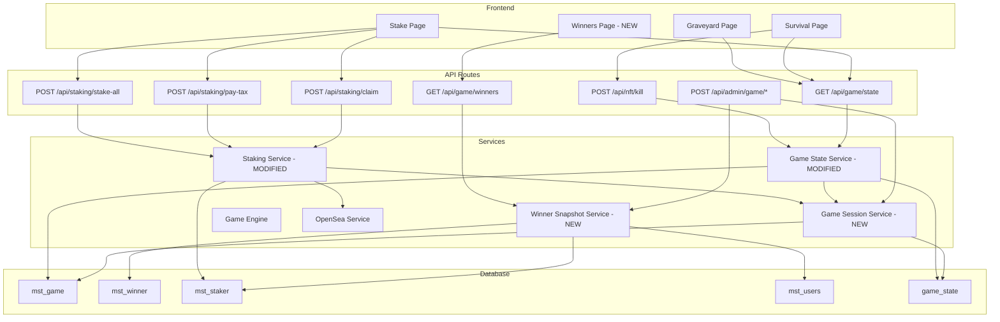
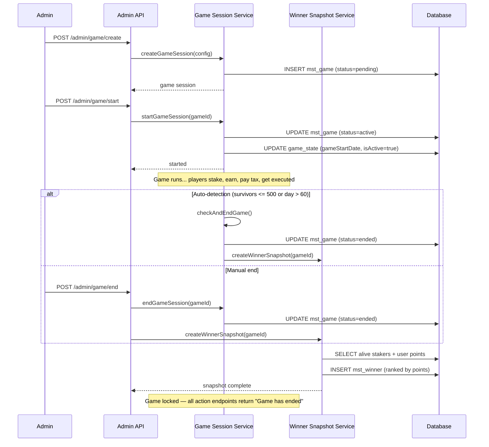
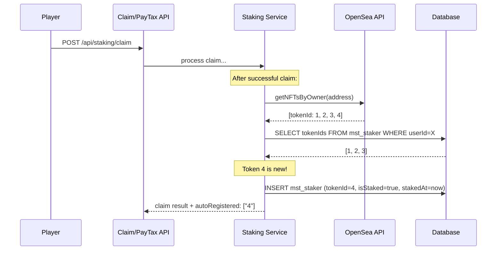
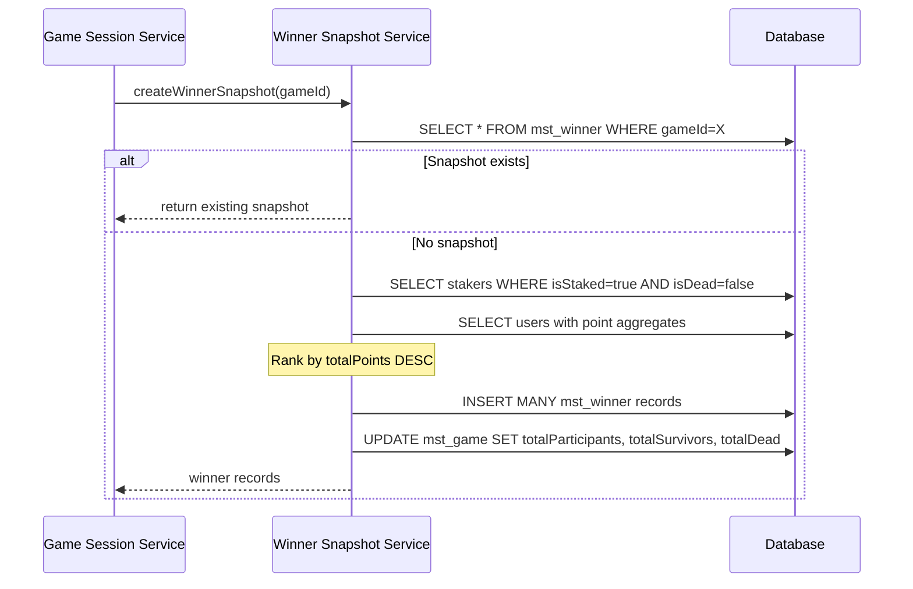

# Design Document: Game System Completion

## Overview

This design completes the PUNKERS NFT survival game system by adding game session management (`mst_game` CRUD), winner snapshot creation (`mst_winner`), auto-registration of new NFTs for participants, a game lock mechanism, and frontend changes (game over banners, winners page, graveyard pagination fixes).

The existing codebase follows a clear pattern: Next.js API routes in `app/api/`, a service layer in `lib/services/`, Prisma ORM with PostgreSQL, and React client components using wagmi for wallet connectivity. The design builds on these patterns without introducing new architectural concepts.

### Key Design Decisions

1. **Game Session Service as a new service file** (`lib/services/game-session-service.ts`) — keeps game session CRUD separate from the existing `game-state-service.ts` which handles runtime state calculations.
2. **Winner Snapshot Service as a new service file** (`lib/services/winner-snapshot-service.ts`) — encapsulates ranking logic and snapshot creation.
3. **Game lock via a shared `isGameLocked()` helper** — called at the top of each game-action API route, following the existing pattern where each route independently checks preconditions.
4. **Auto-registration piggybacks on existing claim/pay-tax flows** — no new cron jobs or background workers needed.
5. **Admin API routes under `app/api/admin/game/`** — follows the existing `app/api/admin/` pattern with `requireAdmin` middleware.

## Architecture



### Game Lifecycle Flow



## Components and Interfaces

### 1. Game Session Service (`lib/services/game-session-service.ts`)

```typescript
// Creates a new game session with status "pending"
export async function createGameSession(config: {
  season: number;
  name: string;
  startDate: Date;
  durationDays?: number;    // default 60
  survivorTarget?: number;  // default 500
}): Promise<MstGame>

// Transitions a pending game to active, syncs gameState table
export async function startGameSession(gameId: string): Promise<MstGame>

// Ends an active game, triggers winner snapshot
export async function endGameSession(
  gameId: string,
  reason: 'manual' | 'survivor_target_reached' | 'duration_ended'
): Promise<MstGame>

// Returns the active game session or null
export async function getActiveGameSession(): Promise<MstGame | null>

// Checks end conditions and auto-ends if met. Called from getGameState().
export async function checkAndEndGame(): Promise<boolean>

// Returns true if the game is locked (ended or no active game)
export async function isGameLocked(): Promise<boolean>
```

### 2. Winner Snapshot Service (`lib/services/winner-snapshot-service.ts`)

```typescript
// Creates winner records for all surviving NFTs, ranked by total points
export async function createWinnerSnapshot(gameId: string): Promise<MstWinner[]>

// Returns paginated winners for a completed game
export async function getWinners(
  gameId: string,
  page: number,
  limit: number
): Promise<{ winners: MstWinner[]; total: number }>

// Checks if a snapshot already exists for a game
export async function hasSnapshot(gameId: string): Promise<boolean>
```

### 3. Auto-Registration Helper (`lib/services/staking-service.ts` — addition)

```typescript
// Detects new NFTs in wallet and auto-stakes them for existing participants
export async function autoRegisterNewNFTs(
  address: string,
  userId: string,
  collectionId: string
): Promise<{ registered: string[] }>
```

### 4. New API Routes

| Route | Method | Auth | Description |
|-------|--------|------|-------------|
| `/api/admin/game/create` | POST | Admin | Create a new game session |
| `/api/admin/game/start` | POST | Admin | Start a pending game session |
| `/api/admin/game/end` | POST | Admin | Manually end an active game |
| `/api/admin/game/active` | GET | Admin | Get active game session |
| `/api/game/winners` | GET | Public | Get winners for a completed game |

### 5. Modified API Routes (Game Lock)

Each of these routes gets a game-lock check at the top:

- `POST /api/staking/stake-all`
- `POST /api/staking/claim`
- `POST /api/staking/pay-tax`
- `POST /api/nft/kill`

Pattern:
```typescript
import { isGameLocked } from '@/lib/services/game-session-service';

// At the top of the handler:
const locked = await isGameLocked();
if (locked) {
  return NextResponse.json(
    { error: 'Game has ended' },
    { status: 403 }
  );
}
```

### 6. Modified Service: `game-state-service.ts`

The `getGameState()` function is modified to:
1. Check `mst_game` for an active session first (new behavior)
2. Fall back to `gameState` table if no `mst_game` record exists (backward compat)
3. Call `checkAndEndGame()` when `isGameComplete` is detected

### 7. Frontend Components

**GameOverBanner** — a shared component displayed on Stake and Survival pages when `isGameComplete` is true. Shows "GAME OVER" with a link to the winners page.

**WinnersPage** (`app/winners/page.tsx`) — displays ranked winners with pagination. Highlights the connected user's NFTs.

**Graveyard fixes** — remove `window.scrollTo` from `goToPage`, replace `styles.btn`/`styles.bo`/`styles.br` with `styles.pageBtn`/`styles.active`.

## Data Models

### Existing Models (no schema changes needed)

The `mst_game` and `mst_winner` models already exist in `prisma/schema.prisma`:

**mst_game** — stores game sessions with season, name, dates, duration, survivor target, tax/earn schedules as JSON, status (pending/active/ended), end reason, and participant counts.

**mst_winner** — stores winner snapshots with gameId, userId, address, tokenId, rank, totalPoints, rarity, survivedDays. Has a unique constraint on `[gameId, tokenId]` to prevent duplicate snapshots.

### Data Flow: Auto-Registration



### Data Flow: Winner Snapshot



### API Endpoint Specifications

#### POST /api/admin/game/create

Request:
```json
{
  "season": 1,
  "name": "Season 1",
  "startDate": "2025-01-15T00:00:00Z",
  "durationDays": 60,
  "survivorTarget": 500
}
```

Response (201):
```json
{
  "success": true,
  "game": {
    "id": "uuid",
    "season": 1,
    "name": "Season 1",
    "startDate": "2025-01-15T00:00:00Z",
    "durationDays": 60,
    "survivorTarget": 500,
    "status": "pending",
    "taxSchedule": [...],
    "earnSchedule": [...]
  }
}
```

Error (409): `{ "error": "An active game session already exists" }`

#### POST /api/admin/game/start

Request: `{ "gameId": "uuid" }`

Response (200):
```json
{
  "success": true,
  "game": { "id": "uuid", "status": "active", "startDate": "..." }
}
```

#### POST /api/admin/game/end

Request: `{ "gameId": "uuid" }`

Response (200):
```json
{
  "success": true,
  "game": { "id": "uuid", "status": "ended", "endReason": "manual" },
  "winnersCount": 487
}
```

#### GET /api/game/winners?gameId=uuid&page=1&limit=50

Response (200):
```json
{
  "success": true,
  "winners": [
    {
      "rank": 1,
      "address": "0x...",
      "tokenId": "42",
      "totalPoints": 15230,
      "rarity": "legendary",
      "survivedDays": 58
    }
  ],
  "pagination": {
    "currentPage": 1,
    "totalPages": 10,
    "totalWinners": 487,
    "hasMore": true
  }
}
```

#### GET /api/admin/game/active

Response (200):
```json
{
  "success": true,
  "game": {
    "id": "uuid",
    "season": 1,
    "name": "Season 1",
    "status": "active",
    "startDate": "...",
    "durationDays": 60,
    "survivorTarget": 500,
    "currentGameDay": 23,
    "currentTaxRate": 35,
    "survivorsRemaining": 3200
  }
}
```


## Correctness Properties

*A property is a characteristic or behavior that should hold true across all valid executions of a system — essentially, a formal statement about what the system should do. Properties serve as the bridge between human-readable specifications and machine-verifiable correctness guarantees.*

### Property 1: Game creation produces a pending session

*For any* valid game configuration (with season, name, and startDate), calling `createGameSession` should return a game record with status "pending", and the stored `taxSchedule` and `earnSchedule` should match the `TAX_SCHEDULE` and `EARNING_SCHEDULE` constants from game-engine.ts.

**Validates: Requirements 1.1, 1.4**

### Property 2: Missing required fields are rejected

*For any* game creation request that is missing at least one of the required fields (season, name, startDate), the service should reject the request with a validation error.

**Validates: Requirements 1.2**

### Property 3: Starting a game transitions to active and syncs gameState

*For any* pending game session, calling `startGameSession` should update the status to "active", set the startDate, and synchronize the `gameState` table's `gameStartDate` and `isActive` fields to match.

**Validates: Requirements 2.1, 2.4**

### Property 4: Only pending games can be started

*For any* game session whose status is not "pending" (i.e., "active" or "ended"), calling `startGameSession` should be rejected with an error.

**Validates: Requirements 2.3**

### Property 5: Active game query returns correct computed fields

*For any* set of game sessions in the database, `getActiveGameSession` should return exactly the one with status "active" (or null if none exists), and the returned object should include correct `currentGameDay`, `currentTaxRate`, and `survivorsRemaining` values computed from the game's startDate and current staker data.

**Validates: Requirements 3.1, 3.2**

### Property 6: Ending a game sets correct status, timestamps, and counts

*For any* active game session, calling `endGameSession` should set status to "ended", set `endedAt` to approximately the current time, set the provided `endReason`, and update `totalParticipants`, `totalSurvivors`, and `totalDead` to match the actual counts from the `mst_staker` table.

**Validates: Requirements 4.1, 4.3**

### Property 7: Ending a game triggers winner snapshot creation

*For any* active game session with surviving NFTs, calling `endGameSession` should result in `mst_winner` records being created for all surviving (alive + staked) NFTs.

**Validates: Requirements 4.2**

### Property 8: Only active games can be ended

*For any* game session whose status is not "active" (i.e., "pending" or "ended"), calling `endGameSession` should be rejected with an error.

**Validates: Requirements 4.4**

### Property 9: Auto-end detection triggers on getGameState

*For any* active game session where the end condition is met (survivors <= survivorTarget OR currentGameDay > durationDays), calling `getGameState()` should trigger the end-game flow and transition the game to "ended" status with the appropriate endReason.

**Validates: Requirements 5.1, 5.2, 5.3, 5.4**

### Property 10: Winner snapshot contains exactly the alive staked NFTs, ranked by points

*For any* set of `mst_staker` records (with varying `isStaked`, `isDead`, and associated user points), calling `createWinnerSnapshot` should produce winner records for exactly those stakers where `isStaked=true` AND `isDead=false`, ranked in descending order of total accumulated points, with each record containing all required fields (gameId, userId, address, tokenId, rank, totalPoints, rarity, survivedDays).

**Validates: Requirements 6.1, 6.2, 6.3**

### Property 11: Winner snapshot creation is idempotent

*For any* gameId, calling `createWinnerSnapshot` twice should produce the same set of winner records — the second call should detect the existing snapshot and return it without creating duplicates.

**Validates: Requirements 6.4**

### Property 12: Winners query returns correctly ordered and paginated results

*For any* completed game with winners and any valid page/limit parameters, the winners endpoint should return results ordered by rank ascending, with the correct slice for the requested page, and the total count should equal the actual number of winner records for that game.

**Validates: Requirements 7.1, 7.2, 7.3**

### Property 13: Auto-registration creates staker records for new wallet NFTs

*For any* participant who calls claim or pay-tax, if their wallet contains NFTs not yet in the `mst_staker` table, the service should create new staker records for each missing NFT with `isStaked=true`, `stakedAt`, `lastTaxPayment`, and `lastClaimDate` all set to approximately the current timestamp.

**Validates: Requirements 9.1, 9.2, 9.4**

### Property 14: Game lock blocks all action endpoints when game is ended

*For any* game session with status "ended", all game action endpoints (stake, stake-all, claim, pay-tax, kill) should reject requests with a "Game has ended" error message.

**Validates: Requirements 10.1, 10.2, 10.3, 10.4, 10.5**

## Error Handling

### Service-Level Errors

| Error Condition | Service | Response |
|----------------|---------|----------|
| Missing required fields on game create | Game Session Service | 400 + descriptive message |
| Active game already exists on create | Game Session Service | 409 + "An active game session already exists" |
| Game not found | Game Session Service | 404 + "Game session not found" |
| Invalid state transition (e.g., start non-pending) | Game Session Service | 400 + "Game cannot be started/ended in current state" |
| Game locked (ended) | All action endpoints | 403 + "Game has ended" |
| Duplicate winner snapshot | Winner Snapshot Service | Return existing (no error) |
| No survivors to snapshot | Winner Snapshot Service | Return empty array (no error) |
| OpenSea API failure during auto-registration | Staking Service | Fail-open: skip auto-registration, log warning |
| Database transaction failure | All services | 500 + "Internal server error" |

### Error Handling Patterns

Following existing codebase patterns:
- API routes use try/catch with `NextResponse.json({ error: message }, { status: code })`
- Admin routes use `requireAdmin` middleware check before any logic
- Services throw errors that are caught by API route handlers
- OpenSea API calls fail-open (return true/skip) to avoid blocking users when external API is down
- Database operations use Prisma transactions (`prisma.$transaction`) for multi-step mutations

## Testing Strategy

### Property-Based Testing

Library: **fast-check** (JavaScript/TypeScript PBT library)

Each correctness property will be implemented as a single property-based test with a minimum of 100 iterations. Tests will use fast-check arbitraries to generate random game configurations, staker sets, and user data.

Tag format: `Feature: game-system-completion, Property {N}: {title}`

Key generators needed:
- `gameConfigArb`: generates valid game session configs (season, name, startDate, durationDays, survivorTarget)
- `stakerSetArb`: generates sets of staker records with varying isStaked/isDead/points
- `paginationArb`: generates valid page/limit combinations

Since the services interact with Prisma, property tests will either:
1. Mock the Prisma client to test pure logic (ranking, filtering, validation)
2. Use an in-memory test database for integration-level property tests

### Unit Tests

Unit tests cover specific examples, edge cases, and integration points:

- Game creation with exact default values (durationDays=60, survivorTarget=500)
- Game creation rejected when active game exists (409)
- Start game with non-existent gameId (404)
- End game with specific endReason values ("survivor_target_reached", "duration_ended", "manual")
- Winner snapshot with 0 survivors (empty result)
- Winner snapshot with tied points (deterministic rank ordering)
- Auto-registration with 0 new NFTs (no-op)
- Auto-registration when OpenSea API is down (fail-open)
- Game lock check with no mst_game records (backward compat — not locked)
- Pagination edge cases: page beyond total, limit=1, limit=100
- Graveyard pagination: verify no `window.scrollTo` call
- Graveyard pagination: verify correct CSS classes (`pageBtn`, `active`)

### Test Organization

```
lib/services/__tests__/
  game-session-service.test.ts      # Unit + property tests for game CRUD
  winner-snapshot-service.test.ts   # Unit + property tests for snapshot
  staking-service.test.ts           # Unit + property tests for auto-registration
  game-lock.test.ts                 # Property tests for game lock across endpoints
app/graveyard/__tests__/
  graveyard-pagination.test.tsx     # Unit tests for pagination fixes
```
