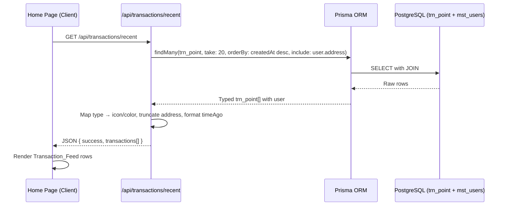

# Design Document: Home Recent Transactions

## Overview

This feature adds a real-time transaction feed to the home page showing the 20 most recent game transactions. It consists of two parts:

1. A new API route (`/api/transactions/recent`) that queries the `trn_point` table, joins with `mst_users` for wallet addresses, and returns enriched transaction objects with icon/color mapping, truncated addresses, and relative time formatting.
2. Integration into the existing home page (`app/page.tsx`) client component to fetch and render the transaction feed using the HTML reference styling.

The design follows existing patterns: Next.js route handlers for the API, Prisma ORM for database access, and client-side `useState`/`useEffect` for data fetching on the home page.

## Architecture



The API layer handles all data enrichment (icon, color, address truncation, time formatting) so the client receives ready-to-render data. This keeps the client thin and avoids duplicating mapping logic.

## Components and Interfaces

### 1. API Route: `app/api/transactions/recent/route.ts`

Single `GET` handler. No authentication required (public feed).

```typescript
// Response shape
interface TransactionResponse {
  success: boolean;
  transactions: RecentTransaction[];
}

interface RecentTransaction {
  id: string;
  type: string;
  points: number;
  description: string;      // display text (from DB or fallback)
  userAddress: string;       // truncated: "0xAAAA...BBBB"
  icon: string;              // emoji mapped from type
  color: string;             // CSS variable mapped from type
  timeAgo: string;           // relative time: "2m ago", "1h ago"
}
```

### 2. Utility: `lib/utils/transactions.ts`

Pure functions extracted for testability:

```typescript
function truncateAddress(address: string): string
function formatTimeAgo(date: Date): string
function getTransactionIcon(type: string): string
function getTransactionColor(type: string): string
function getTransactionLabel(type: string): string
function buildDescription(tx: { description: string | null; type: string }, truncatedAddress: string): string
```

### 3. Home Page Integration: `app/page.tsx`

Modify the existing client component:
- Add a `useEffect` to fetch `/api/transactions/recent` on mount
- Replace the static `recentTx` state with fetched data
- Render each transaction row matching the HTML reference styling (icon 18px, description flex:1, time right-aligned, monospace 14px, border-bottom)

### Type/Icon/Color Mapping Table

| Transaction_Type     | Icon | Color                    | Fallback Label            |
|---------------------|------|--------------------------|---------------------------|
| EARNING_CLAIM       | 💎   | var(--accent-green)      | claimed earnings          |
| TAX_PAYMENT         | 💸   | var(--accent-red)        | paid tax                  |
| SLOT_BET            | 🎰   | var(--accent-red)        | bet on Slot Machine       |
| SLOT_WIN            | 🎰   | var(--accent-yellow)     | won on Slot Machine       |
| LOOT_OPEN           | 📦   | var(--text-secondary)    | opened Loot Chest         |
| LOOT_WIN            | 📦   | var(--accent-purple)     | won Loot prize            |
| EXECUTION_BOUNTY    | 💀   | var(--accent-green)      | earned execution bounty   |
| AUDIT_BOUNTY        | 🎯   | var(--accent-green)      | earned audit bounty       |
| penalty             | 💀   | var(--accent-red)        | received death penalty    |
| AUDIT_PENALTY       | ⚠️   | var(--accent-red)        | received audit penalty    |
| EXECUTION_FORFEIT   | ⚔️   | var(--accent-red)        | forfeited earnings        |

## Data Models

### Existing: `trn_point` table (no changes)

| Field       | Type     | Notes                          |
|-------------|----------|--------------------------------|
| id          | String   | UUID, primary key              |
| userId      | String   | FK → mst_users.id              |
| points      | Int      | Transaction amount             |
| description | String?  | Optional description text      |
| type        | String   | Transaction type enum string   |
| createdAt   | DateTime | Timestamp, used for ordering   |

### Existing: `mst_users` table (no changes, joined for address)

| Field   | Type   | Notes                    |
|---------|--------|--------------------------|
| id      | String | UUID, primary key        |
| address | String | Ethereum wallet address  |

### API Response Model: `RecentTransaction`

| Field       | Type   | Source                                              |
|-------------|--------|-----------------------------------------------------|
| id          | string | `trn_point.id`                                      |
| type        | string | `trn_point.type`                                    |
| points      | number | `trn_point.points`                                  |
| description | string | `trn_point.description` or generated fallback       |
| userAddress | string | Truncated `mst_users.address` → `0xAAAA...BBBB`    |
| icon        | string | Mapped from `type` via lookup table                 |
| color       | string | Mapped from `type` via lookup table                 |
| timeAgo     | string | Computed from `trn_point.createdAt` vs server time  |

No database migrations are needed. The feature reads existing data only.


## Correctness Properties

*A property is a characteristic or behavior that should hold true across all valid executions of a system — essentially, a formal statement about what the system should do. Properties serve as the bridge between human-readable specifications and machine-verifiable correctness guarantees.*

### Property 1: Query result limit and ordering

*For any* set of transactions in the database, the API response SHALL contain at most 20 transactions, and they SHALL be ordered by `createdAt` descending (each transaction's `createdAt` is ≥ the next one's).

**Validates: Requirements 1.1**

### Property 2: Query result type filtering

*For any* set of transactions returned by the API, every transaction's `type` field SHALL be one of the allowed game types: `EARNING_CLAIM`, `TAX_PAYMENT`, `SLOT_BET`, `SLOT_WIN`, `LOOT_OPEN`, `LOOT_WIN`, `EXECUTION_BOUNTY`, `AUDIT_BOUNTY`, `penalty`, `AUDIT_PENALTY`, `EXECUTION_FORFEIT`.

**Validates: Requirements 1.2**

### Property 3: Address truncation format

*For any* valid Ethereum address (starting with `0x` followed by 40 hex characters), `truncateAddress` SHALL return a string matching the pattern `0xHHHH...HHHH` where the first 6 characters match the input's first 6 characters and the last 4 characters match the input's last 4 characters.

**Validates: Requirements 1.4**

### Property 4: Relative time formatting buckets

*For any* non-negative time difference in seconds between server time and a transaction's `createdAt`:
- If < 60 seconds → output matches `"Xs ago"` where X is the floored seconds
- If 60–3599 seconds → output matches `"Xm ago"` where X is the floored minutes
- If 3600–86399 seconds → output matches `"Xh ago"` where X is the floored hours
- If ≥ 86400 seconds → output matches `"Xd ago"` where X is the floored days

**Validates: Requirements 2.1**

### Property 5: Description builder logic

*For any* transaction with a non-null, non-empty `description` field, `buildDescription` SHALL return that description unchanged. *For any* transaction with a null or empty `description`, `buildDescription` SHALL return a string in the format `"{truncatedAddress} {typeLabel}"` where `typeLabel` is the human-readable label for the transaction type.

**Validates: Requirements 4.1, 4.2**

### Property 6: Type-to-icon and type-to-color mapping completeness

*For any* valid game transaction type, `getTransactionIcon` SHALL return a non-empty string (emoji), and `getTransactionColor` SHALL return a non-empty string (CSS variable). No valid type shall produce an undefined or empty mapping.

**Validates: Requirements 1.5, 1.6**

### Property 7: Transaction row rendering completeness

*For any* `RecentTransaction` object, the rendered transaction row SHALL contain the transaction's `icon`, `description`, and `timeAgo` text, and the icon element SHALL be styled with the transaction's `color` value.

**Validates: Requirements 3.2, 3.3**

## Error Handling

| Scenario | Layer | Behavior |
|----------|-------|----------|
| Database query fails | API (`/api/transactions/recent`) | Return `{ error: "Failed to fetch recent transactions" }` with HTTP 500. Log error via `console.error`. |
| API fetch fails (network error, 5xx) | Home Page (client) | Silently catch error, keep `recentTx` as empty array. Display existing empty state (`📭 No transactions yet`). No error toast or message shown to user. |
| Transaction has unknown type | API mapping | Return a default icon (`📋`) and default color (`var(--text-secondary)`). This prevents crashes if new types are added to the DB before the mapping is updated. |
| User address is null/missing | API mapping | Return `"0x0000...0000"` as fallback truncated address. |
| Transaction has null description | API mapping | Generate fallback text via `buildDescription` (covered by Requirement 4.2). |

## Testing Strategy

### Unit Tests

Unit tests cover specific examples, edge cases, and integration points:

- `truncateAddress`: standard address, short address edge case, missing `0x` prefix
- `formatTimeAgo`: boundary values (0s, 59s, 60s, 3599s, 3600s, 86399s, 86400s)
- `getTransactionIcon` / `getTransactionColor`: exhaustive check of all 11 transaction types against expected values, plus unknown type fallback
- `buildDescription`: with description, without description, empty string description
- API route: mock Prisma, verify response shape and HTTP 500 on error
- Home page: mock fetch, verify loading state shows empty state, verify error state shows empty state

### Property-Based Tests

Property-based tests use `fast-check` to verify universal properties across randomized inputs. Each test runs a minimum of 100 iterations.

Each property test references its design document property:

- **Feature: home-recent-transactions, Property 3: Address truncation format** — Generate random valid Ethereum addresses, verify `truncateAddress` output matches `0xHHHH...HHHH` pattern with correct prefix/suffix.
- **Feature: home-recent-transactions, Property 4: Relative time formatting buckets** — Generate random non-negative integers (seconds), verify `formatTimeAgo` output matches the correct bucket format.
- **Feature: home-recent-transactions, Property 5: Description builder logic** — Generate random transactions with and without descriptions, verify `buildDescription` returns description when present or fallback format when absent.
- **Feature: home-recent-transactions, Property 6: Type mapping completeness** — Generate random valid transaction types from the allowed set, verify both `getTransactionIcon` and `getTransactionColor` return non-empty strings.
- **Feature: home-recent-transactions, Property 7: Transaction row rendering** — Generate random `RecentTransaction` objects, render the transaction row component, verify the output contains icon, description, and timeAgo.

Properties 1 and 2 (query limit/ordering and type filtering) are best validated as integration tests against a test database or mocked Prisma layer, since they depend on the database query behavior.

### Test Library

- **Property-based testing**: `fast-check` (JavaScript/TypeScript PBT library)
- **Test runner**: The project's existing test framework (Jest or Vitest)
- **Minimum iterations**: 100 per property test
- **Tag format**: `Feature: home-recent-transactions, Property {number}: {property_text}`
